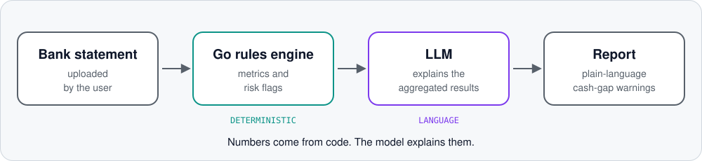

## English

**Applied AI builder.** I build LLM-powered tools and automation. My rule of thumb: code owns the numbers, the model explains and decides what to say.

### Now
- **Sber**: Systems Analyst Intern, working on AI automation.
- **Nexara**: shipping in versioned releases with a changelog.

### Selected work

| Project | What it is | Repo |
|---|---|---|
| **FinAudit** | Spots cash shortfalls from a bank statement and flags tax, legal and counterparty risks. Go code calculates the metrics, an LLM explains the aggregated results. Team captain at the 2026 Kodik LaunchPad Hackathon (90/100 in Kodik's assessment). | [Public](https://github.com/lcvtlcl/FinAudit-Public-repository) |
| **Nexara** | Control plane for proxy nodes and the servers they run on. Go backend, React UI, signed operations, an MCP interface for AI agents. | Private |
| **MopsVPN** | Subscription service with card and SBP payments, Telegram bots and a landing page. Go, Next.js, PostgreSQL. | Private |

<picture>
  <source media="(prefers-color-scheme: dark)" srcset="assets/finaudit-flow-dark.svg">
  
</picture>

### Stack
Go · Python · TypeScript / React / Next.js · SQL / PostgreSQL · Docker · LLM APIs · MCP · Telegram bots

I build with AI coding assistants every day.

---

## Русский

**Applied AI builder.** Делаю инструменты и автоматизацию на LLM. Мой принцип: цифры считает код, а модель объясняет и решает, что сказать.

### Сейчас
- **Сбер**: Systems Analyst Intern, занимаюсь AI-автоматизацией.
- **Nexara**: выпускаю версиями, с журналом изменений.

### Избранные проекты

| Проект | Что это | Репозиторий |
|---|---|---|
| **FinAudit** | По банковской выписке находит кассовые разрывы и отмечает налоговые, правовые и контрагентские риски. Метрики считает код на Go, LLM объясняет агрегированные результаты. Капитан команды на хакатоне Kodik LaunchPad 2026 (90/100 по оценке Kodik). | [Публичный](https://github.com/lcvtlcl/FinAudit-Public-repository) |
| **Nexara** | Консоль управления прокси-узлами и серверами, на которых они работают. Бэкенд на Go, интерфейс на React, подписанные операции, MCP-интерфейс для AI-агентов. | Закрытый |
| **MopsVPN** | Сервис подписок с оплатой картой и через СБП, Telegram-боты и лендинг. Go, Next.js, PostgreSQL. | Закрытый |

<picture>
  <source media="(prefers-color-scheme: dark)" srcset="assets/finaudit-flow-dark.svg">
  
</picture>

### Стек
Go · Python · TypeScript / React / Next.js · SQL / PostgreSQL · Docker · LLM API · MCP · Telegram-боты

Каждый день работаю с AI-ассистентами для разработки.
