<picture>
  <source media="(prefers-color-scheme: dark)" srcset="assets/banner-dark.svg">
  
</picture>

**[English](#english) · [Русский](#русский)**

## English

**Applied AI builder.** I build LLM-powered tools and agents. My rule of thumb: code owns the numbers, the model explains and decides what to say.

Looking for graduate and junior roles in applied AI and AI automation.

### Now
- **Sber**: Systems Analyst Intern, working on AI automation.
- **Nexara**: shipping in versioned releases with a changelog.

### Selected work

| Project | What it is | Repo |
|---|---|---|
| **FinAudit** | Spots cash shortfalls from a bank statement and flags tax, legal and counterparty risks. Go code calculates the metrics, an LLM explains the aggregated results. Team captain at the 2026 Kodik LaunchPad Hackathon (90/100 in Kodik's assessment). | [Public](https://github.com/lcvtlcl/FinAudit-Public-repository) |
| **Litmus** | "git diff for model behavior." Runs a baseline and a candidate config on the same inputs and produces a categorized diff: refusals, format breaks, length, cost, latency. Deterministic-first, DeepSeek and Anthropic adapters, Go. | Private |
| **Nexara** | Control plane for proxy nodes and the servers they run on. Go backend, React UI, signed operations, an MCP interface for AI agents. | Private |
| **LLM-RPG** | Multiplayer Telegram role-play game where an LLM game master acts through tools. Hidden roles and private channels: who may see which fact is enforced in code, not by the model. Python, PostgreSQL, Docker. | Private |
| **Hermes agents** | Configs of two personal Telegram agents: a secretary (reminders, schedule, no terminal access) and a coder (code, tests, pull requests, cannot push to `main`). | Private |
| **MopsVPN** | Subscription service with card and SBP payments, Telegram bots and a landing page. Go, Next.js, PostgreSQL. | Private |

<picture>
  <source media="(prefers-color-scheme: dark)" srcset="assets/finaudit-flow-dark.svg">
  
</picture>

### Stack
Go · Python · TypeScript / React / Next.js · SQL / PostgreSQL · Docker · LLM APIs (DeepSeek, Anthropic) · tool-calling agents · MCP · Telegram bots

I build with AI coding assistants every day.

---

## Русский

**Applied AI builder.** Делаю инструменты и агентов на LLM. Мой принцип: цифры считает код, а модель объясняет и решает, что сказать.

Ищу graduate- и junior-позиции в applied AI и автоматизации с помощью AI.

### Сейчас
- **Сбер**: Systems Analyst Intern, занимаюсь AI-автоматизацией.
- **Nexara**: выпускаю версиями, с журналом изменений.

### Избранные проекты

| Проект | Что это | Репозиторий |
|---|---|---|
| **FinAudit** | По банковской выписке находит кассовые разрывы и отмечает налоговые, правовые и контрагентские риски. Метрики считает код на Go, LLM объясняет агрегированные результаты. Капитан команды на хакатоне Kodik LaunchPad 2026 (90/100 по оценке Kodik). | [Публичный](https://github.com/lcvtlcl/FinAudit-Public-repository) |
| **Litmus** | «git diff для поведения модели». Прогоняет базовую и новую конфигурацию на одних и тех же входах и строит категоризованный дифф: отказы, поломка формата, длина, стоимость, задержка. Детерминированное ядро, адаптеры DeepSeek и Anthropic, Go. | Закрытый |
| **Nexara** | Консоль управления прокси-узлами и серверами, на которых они работают. Бэкенд на Go, интерфейс на React, подписанные операции, MCP-интерфейс для AI-агентов. | Закрытый |
| **LLM-RPG** | Многопользовательская ролевая игра в Telegram, где ведущий — LLM-агент, действующий через инструменты. Скрытые роли и приватные каналы: кто какой факт видит, определяет код, а не модель. Python, PostgreSQL, Docker. | Закрытый |
| **Hermes agents** | Настройки двух личных Telegram-агентов: секретарь (напоминания, расписание, без доступа к терминалу) и кодер (код, тесты, pull request'ы, в `main` не пушит). | Закрытый |
| **MopsVPN** | Сервис подписок с оплатой картой и через СБП, Telegram-боты и лендинг. Go, Next.js, PostgreSQL. | Закрытый |

<picture>
  <source media="(prefers-color-scheme: dark)" srcset="assets/finaudit-flow-dark.svg">
  
</picture>

### Стек
Go · Python · TypeScript / React / Next.js · SQL / PostgreSQL · Docker · LLM API (DeepSeek, Anthropic) · агенты с вызовом инструментов · MCP · Telegram-боты

Каждый день работаю с AI-ассистентами для разработки.
